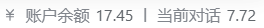

<p align="center">
  
</p>

# dsh-composer-balance

[](https://www.npmjs.com/package/dsh-composer-balance)
[](LICENSE)

<!--
截图：把两张图放到 docs/ 下，然后取消注释。发布前请把余额与会话内容打码或换成假数据。

[](docs/card.png)

收录到开放插件市场后再启用这枚徽章：

[](https://dshopen.org/zh/plugins/dsh-composer-balance/)
-->

A minimal balance chip for [DeepSeek Harness](https://github.com/deepseek-ai/deepseek-harness): one line in the composer dock showing the account
balance and what the current session has cost, in the host's own visual
language.

```
◔ 42%   ¥ 14.55 │ 0.003
```

Clicking the chip opens a small card (264px, the same box the host's context
card uses):

```
账户余额            ¥14.55
充值 ¥14.55 · 赠送 ¥0.00
───────────────────────────
当前会话            ¥0.003
输入 35.2K · 输出 800 · 命中 96.6%
───────────────────────────
12:34 更新            (↻) (⚙)
```

## What it does

- **Balance** — read from DeepSeek's `/user/balance` on the host, cached for
  `refreshIntervalMs`; the browser never holds the API key.
- **Current session spend** — priced per settlement: the plugin registers its
  own session projection (`composerBalanceCost`) that folds each provider usage
  sample and charges it at the tariff in force **at that turn's own timestamp**
  (peak 09–12 / 14–18 CST weekdays costs double). A session that spans peak and
  off-peak therefore adds up correctly instead of being priced at whatever
  tariff happens to be live when the chip renders. Offline replay of a real
  session matched the account's own daily figure within a few percent.
- **One card** — balance, session, last update, refresh and settings. Nothing
  else competes for attention.
- **Native look and feel** — the chip uses the same geometry as the context
  meter beside it; the card uses `--dsw-specific-menu`, `--dsw-elevation-prominent`,
  `--dsw-radius-lg` and a 12px/20px rhythm. Click to open, `Esc` or an outside
  click to close.
- **Local settings** — warning / critical thresholds (they only colour the ¥
  icon) and the auto-refresh interval, stored in `localStorage`.

## Install

```sh
dsh plugin --profile web add dsh-composer-balance   # once published
# or from a checkout / local directory:
dsh plugin --profile web add /path/to/dsh-composer-balance
```

Then restart the harness (`sudo systemctl restart dsh-web` for a systemd
deployment) and reload the page.

If you also run another balance chip in the composer, disable one of them —
each entry renders its own chip.

## How the session figure is produced

```
余额变动  ¥2.83 · 按轮计价 ¥6.49          ← 两个来源都显示出来
输入 106.3M · 输出 344.7K · 命中 99.8% · 按轮计价
```

- **按轮计价** is the primary figure: every provider usage sample is priced at its
  own timestamp (peak/off-peak aware), summed over the session. It is the number
  the provider would bill for that session's tokens.
- **余额变动** is the accumulated drop of the account balance since the chip
  started watching. It is the ground truth for "what left my account", but it
  also includes any other activity on the same key.
- The displayed value never walks backwards: it is the max of the two and of the
  highest value already shown for that session.

## Configuration

Write overrides into your profile's `cordis.patch.yml`:

```yaml
- id: dsh-composer-balance
  config:
    apiKeyRef: DEEPSEEK_API_KEY       # credential reference holding the key
    baseUrl: https://api.deepseek.com # /user/balance is appended
    refreshIntervalMs: 120000         # how long one reading stays fresh
    warningThreshold: 10              # chip turns amber at or below this
    dangerThreshold: 5                # chip turns red at or below this
    defaultPrice: { cacheHit: 0.2, cacheMiss: 2, output: 8 }  # ¥ / 1M tokens
    modelPrices:                      # per-model overrides
      deepseek-flash: { cacheHit: 0.02, cacheMiss: 1, output: 2 }
```

`defaultPrice` / `modelPrices` ship with placeholder numbers — replace them with
the provider's current list price so the session estimate is meaningful. Tokens
are always shown; a missing price only greys out the amount.

## Notes

- The route is read-only and never returns the API key; it sits behind the same
  fence as the rest of the web app.
- The entry renders last in the composer dock (`order: 1`), so it lines up after
  the host's token/context meter.
- The bundle is written against the host's public client seats: the
  `conversation.composer.dock` slot, the `tokenUsage` projection, and locale
  dictionaries.

## Licence

MIT — see [LICENSE](LICENSE). This is an independent implementation; it shares
no code with other balance plugins.
